# Bugando PGS: system flows (as-is) and rewrite target

This document maps every runtime flow in the current Payment Gateway System (PGS) and proposes the
target architecture for the rewrite. All file references are relative to `ci/app/` unless stated.

- Live base URL (from `Controllers/Malipo.php` test calls): `https://bmc.lipaswitch.co.tz/`
- Install-time base URL: `http://<host>/bmc/public/`
- eHMS (hospital system) host: `http://10.15.0.21:30005/ehms/payment/*`

## Contents

1. [Actors and system context](#1-actors-and-system-context)
2. [Request pipeline (every request)](#2-request-pipeline-every-request)
3. [Remote kill switch](#3-remote-kill-switch)
4. [Bill creation: eHMS to PGS](#4-bill-creation-ehms-to-pgs)
5. [Control number generation](#5-control-number-generation)
6. [Reference lookup (shared by bill intake and every bank)](#6-reference-lookup)
7. [Bank / mobile-money validation flows](#7-bank--mobile-money-validation-flows)
8. [Payment posting and settlement](#8-payment-posting-and-settlement)
9. [Payment sync back to eHMS (cron)](#9-payment-sync-back-to-ehms-cron)
10. [Reconciliation and other jobs](#10-reconciliation-and-other-jobs)
11. [Bill lifecycle state](#11-bill-lifecycle-state)
12. [Endpoint inventory](#12-endpoint-inventory)
13. [Defects by flow](#13-defects-by-flow)
14. [Target architecture for the rewrite](#14-target-architecture-for-the-rewrite)

---

## 1. Actors and system context

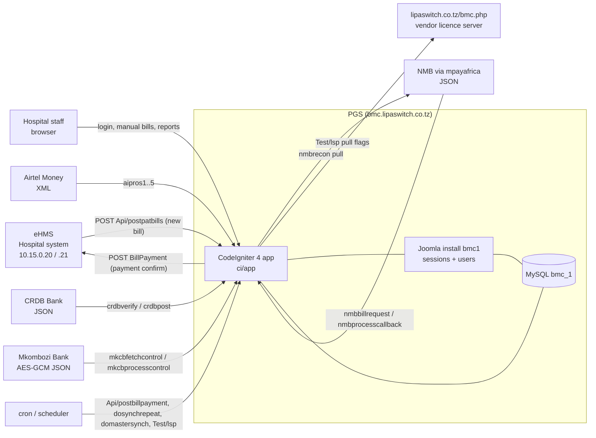

## 2. Request pipeline (every request)

Every request (staff UI, eHMS, banks, crons) goes through the same boot path.

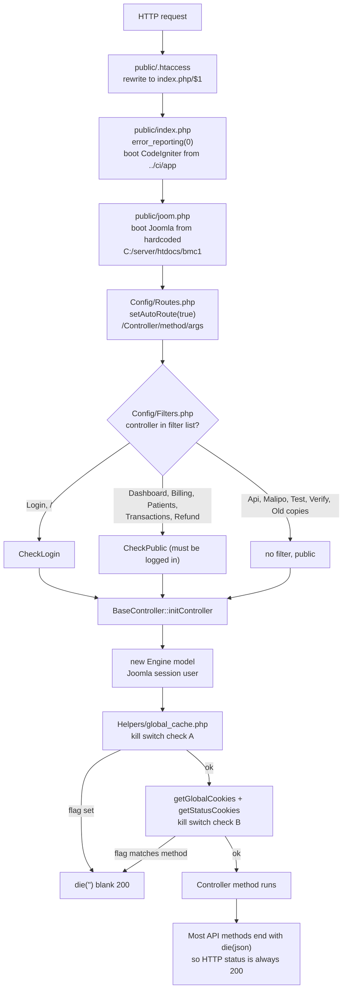

## 3. Remote kill switch

A vendor-controlled switch decides whether PGS serves requests. It is checked on every request,
including eHMS bill intake and bank payment callbacks.

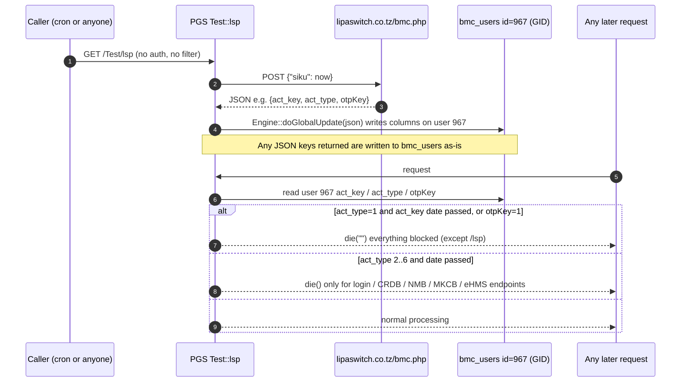

| `act_type` | Blocked methods (`Helpers/global_helper.php:874`) |
|---|---|
| 1 | everything |
| 2 | `process` (staff login) |
| 3 | `crdbverify`, `crdbpost` |
| 4 | `nmbbillrequest`, `nmbprocesscallback` |
| 5 | `mkcbfetchcontrol`, `mkcbprocesscontrol` |
| 6 | `postpatbills`, `postbillpayment` (eHMS integration) |

## 4. Bill creation: eHMS to PGS

Entry point: `POST https://bmc.lipaswitch.co.tz/api/postpatbills` → `Controllers/Api.php:56`.

### 4.1 Sequence

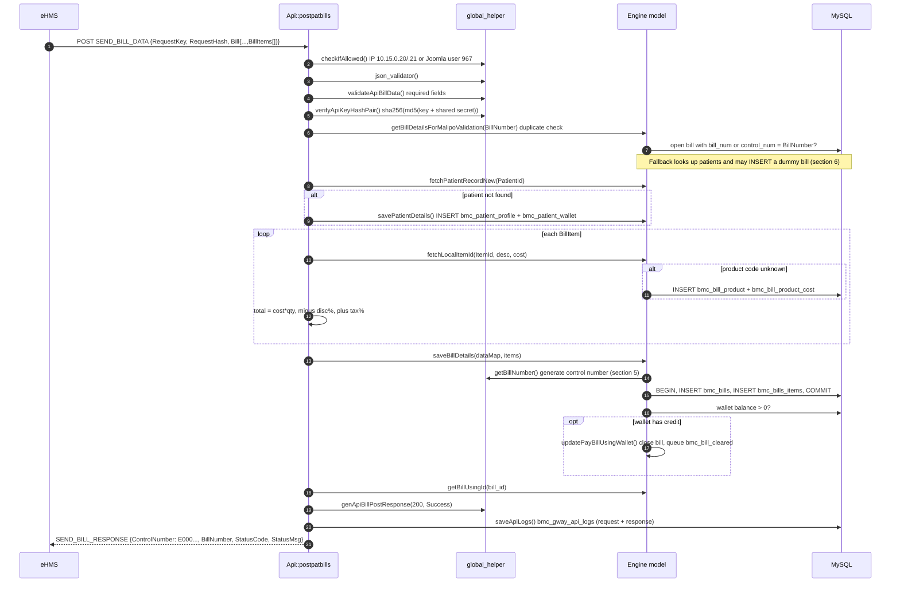

### 4.2 Decision flow

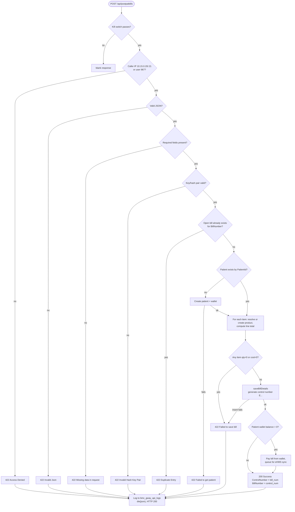

### 4.3 Field mapping

| eHMS request field | PGS storage | Used? |
|---|---|---|
| `Bill.BillNumber` | `bmc_bills.control_num` (naming is inverted) | yes |
| `Bill.PatientId` | `bmc_patient_profile.pat_num` | yes |
| `Bill.PatientName` | split on first space into `sur_name` / `other_names` | only for new patients |
| `Bill.PatientPhone` | `bmc_patient_profile.phone` | only for new patients |
| `Bill.BillTotal` | not stored, not checked | no |
| `Bill.AmountPaid` | ignored | no |
| `Bill.BillCreatedDate` | `bmc_bills.bill_creation` | yes |
| `Bill.BillExpiryDate` | read, never stored | no |
| `BillItems[].ItemId` | `bmc_bill_product.prod_code` | yes |
| `BillItems[].ItemCost/Qty/Tax/Discount` | `bmc_bills_items`, cast to `int` | yes, decimals dropped |
| generated | `bmc_bills.bill_num` = `E` + 14 digits → returned as `ControlNumber` | yes |

## 5. Control number generation

`Engine::saveBillDetails` → `getBillNumber()` (`Helpers/global_helper.php:929`).

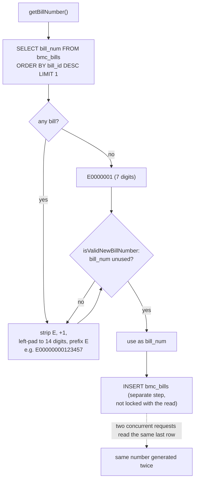

Each bank then sees the control number with its own prefix: CRDB `BMH` + ref, NMB `SAS169` + ref,
Mkombozi `BMH999` + ref. PGS strips the prefix before lookup.

## 6. Reference lookup

`Engine::getBillDetailsForMalipoValidation($ref)` (`Models/Engine.php:1758`) is used by bill intake
(duplicate check), every bank validation, and every payment post.

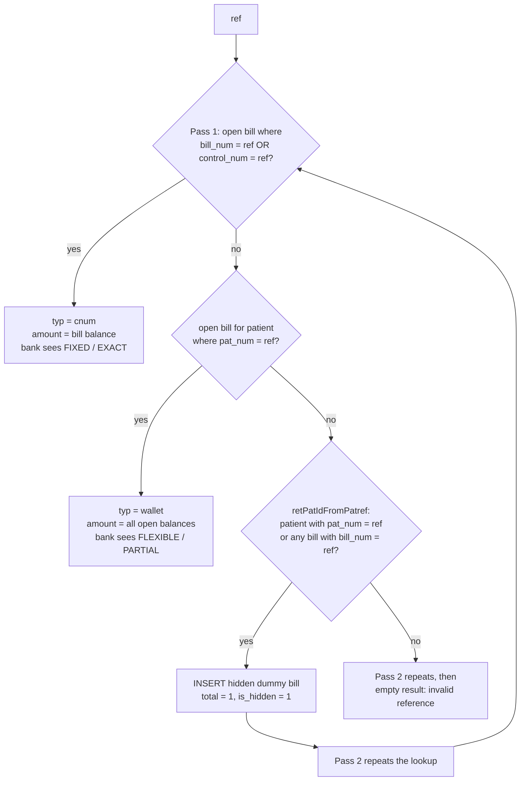

Side effect: a read-only lookup can write a bill. Any bank lookup on a patient number with no open
bills creates a dummy bill of TZS 1.

## 7. Bank / mobile-money validation flows

Before taking money, each channel asks PGS "is this reference payable and for how much".

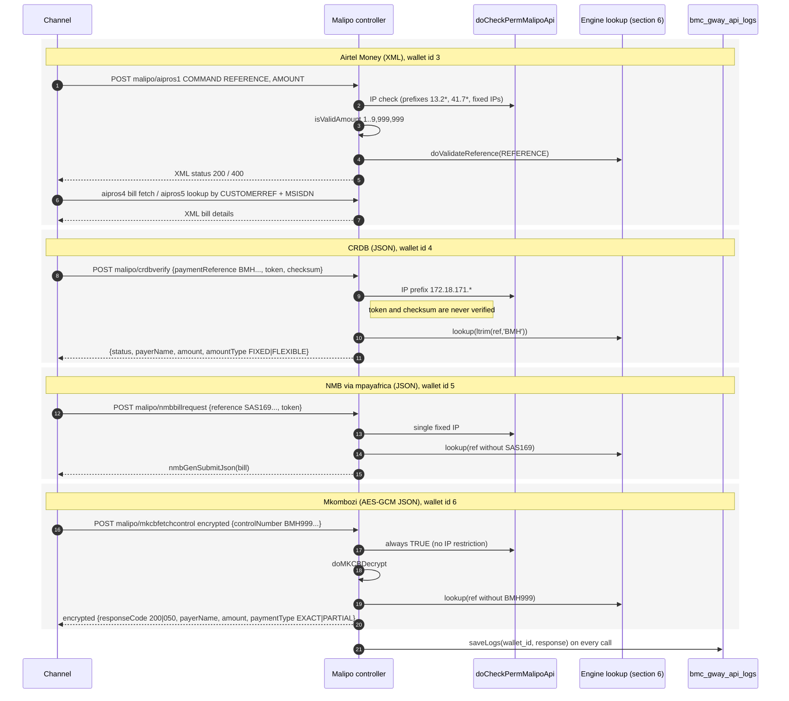

## 8. Payment posting and settlement

All channels converge on `doProcessGlobalTransaction($trans_sp, $req)` (`Helpers/global_helper.php:541`).

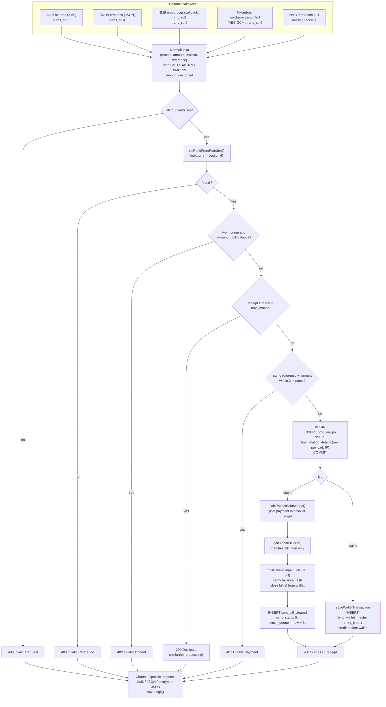

## 9. Payment sync back to eHMS (cron)

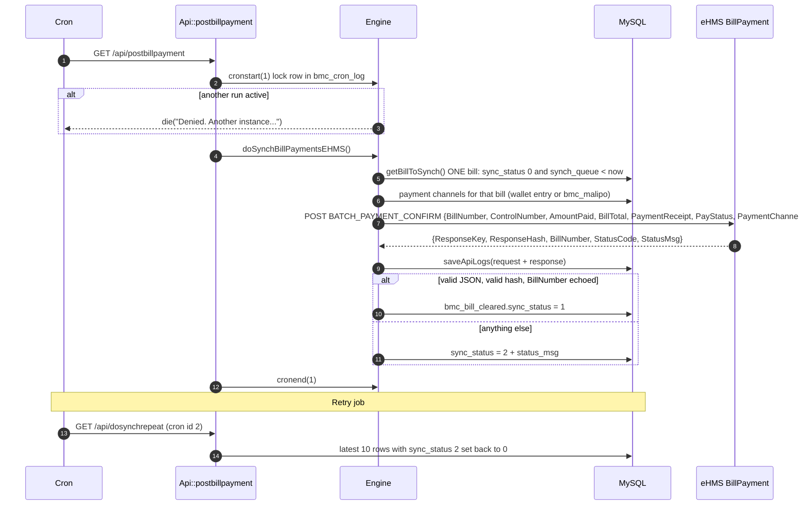

Throughput is one bill per cron run. eHMS `StatusCode` is read but not checked; only the echoed
`BillNumber` decides success.

## 10. Reconciliation and other jobs

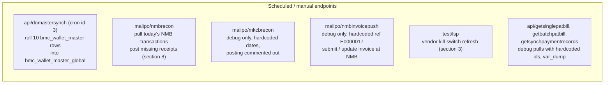

Staff UI flows (behind Joomla login): `Billing::postnewbill` creates manual bills through the same
`saveBillDetails` (there `control_num` = `bill_num`), plus patients, wallet statements,
transactions, refunds and reports.

## 11. Bill lifecycle state

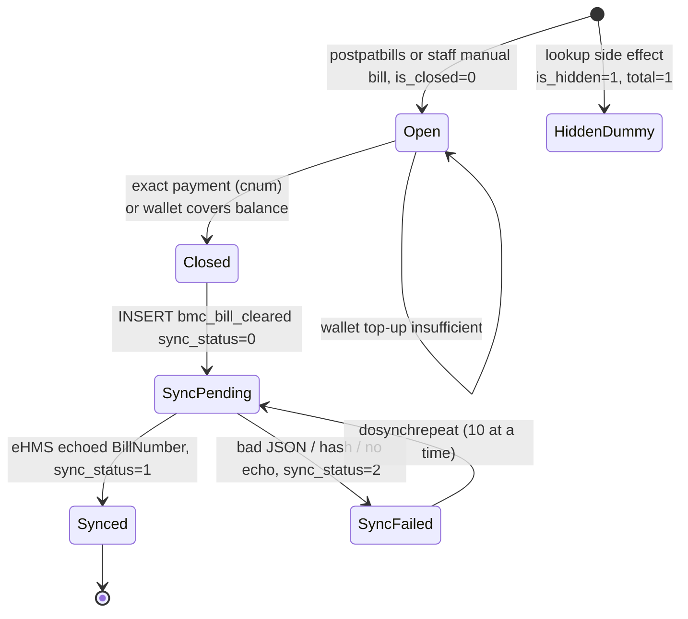

There is no Expired or Cancelled state: `BillExpiryDate` is ignored and `nmbBillCancel` is never
called from a live path.

## 12. Endpoint inventory

| Endpoint | Caller | Auth today | Purpose |
|---|---|---|---|
| `api/postpatbills` | eHMS | IP allowlist (spoofable) + static key/hash | create bill, return control number |
| `api/postbillpayment` | cron | none | push one paid bill to eHMS |
| `api/dosynchrepeat` | cron | none | requeue failed syncs |
| `api/domastersynch` | cron | none | global ledger roll-up |
| `api/index`, `api/testpush`, `api/get*` | nobody | none | debug, leaks sample data |
| `malipo/aipros1..5` | Airtel | IP prefix | validate, pay, query, bill fetch, lookup |
| `malipo/crdbverify`, `crdbpost` | CRDB | IP prefix, token unchecked | validate, pay |
| `malipo/nmbbillrequest`, `nmbprocesscallback`, `nmbreq1/2` | NMB | single IP | validate, pay |
| `malipo/mkcbfetchcontrol`, `mkcbprocesscontrol` | Mkombozi | AES-GCM key only | validate, pay |
| `malipo/nmbrecon`, `mkcbrecon`, `nmbinvoicepush`, `index`, `test` | manual | none | recon and debug |
| `test/*` | anyone | none | balance recalculation, bill charging, kill switch |
| `MalipoOld/*`, `MalipoBk/*`, `MalipoApril/*`, `DashboardBkApril24/*` | anyone | none | old copies still routable |

## 13. Defects by flow

| # | Flow | Defect | Where |
|---|---|---|---|
| 1 | All | Vendor remote kill switch can block any endpoint; refresh endpoint is public | `Helpers/global_cache.php`, `global_helper.php:874`, `Controllers/Test.php:lsp`, `Engine::doGlobalUpdate` |
| 2 | All | Legacy auto-routing exposes every public method incl. debug and old copies | `Config/Routes.php` |
| 3 | All | SQL built by string interpolation of request values | `Models/Engine.php` throughout |
| 4 | All | Secrets in source control (DB, NMB, MKCB, eHMS shared secret) | `Config/Database.php`, `Config/Constants.php`, `global_helper.php`, `backup.sh` |
| 5 | Bill intake | Key/hash pair is replayable forever, not bound to body or time | `global_helper.php:1084-1104` |
| 6 | Bill intake | IP check trusts `X-Forwarded-For` / `Client-IP`; user 967 bypasses it | `global_helper.php:286`, `:1222` |
| 7 | Bill intake | Duplicate check ignores closed bills, so a paid bill can be re-created | `Engine.php:1758` |
| 8 | Bill intake | Lookup can insert a dummy bill and then reject the real one as duplicate | `Engine.php:1792-1821` |
| 9 | Bill intake | Money cast to `int`; `BillTotal` never compared; tax/discount assumed percent | `Api.php:153-195` |
| 10 | Control number | Generated outside the transaction, no lock: concurrent duplicates | `global_helper.php:929` |
| 11 | Control number | First number 7 digits, later 15 characters | `global_helper.php:942` |
| 12 | Validation | CRDB `token`/`checksum` never verified; Mkombozi has no IP restriction | `Malipo.php:276`, `global_helper.php:213` |
| 13 | Validation | `ltrim($ref,'BMH')` strips any leading B/M/H characters, not the prefix | `global_helper.php:350`, `:489` |
| 14 | Payment | `getGlobalBillId` matches `bill_num` only; payment by hospital bill number settles nothing specific | `Engine.php:2540` |
| 15 | Payment | Duplicate-receipt check and insert are not atomic (no unique key relied on) | `Engine.php:2027` |
| 16 | eHMS sync | One bill per run; eHMS `StatusCode` ignored; HTTP not TLS | `Engine.php:342` |
| 17 | Errors | `die()` everywhere, HTTP status always 200, `error_reporting(0)` | `public/index.php`, helpers |
| 18 | Structure | Two frameworks per request; absolute Windows path; 3,000-line model; global `get_instance()` | `public/joom.php`, `Models/Engine.php` |

---

## 14. Target architecture for the rewrite

### 14.1 Principles

- One application, one framework. Staff auth moves into the app (no Joomla).
- Explicit routes only. No auto-routing. Debug endpoints do not ship.
- Each external party gets its own adapter with its own authentication, and talks to the same
  core services.
- Money is stored as integer cents (TZS has no minor unit in practice, so store whole shillings as
  `BIGINT` and reject fractional input explicitly rather than truncating).
- Every write that must happen once is enforced by a database unique key, not by a prior SELECT.
- Calls out to eHMS go through a transactional outbox and a worker with retry and backoff.
- Real HTTP status codes; structured JSON errors; no `die()`.
- Secrets come from environment / a secret store, never from source.

### 14.2 Component view

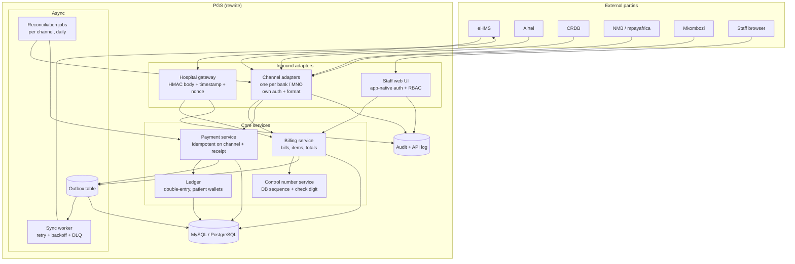

### 14.3 Target: bill creation and control number

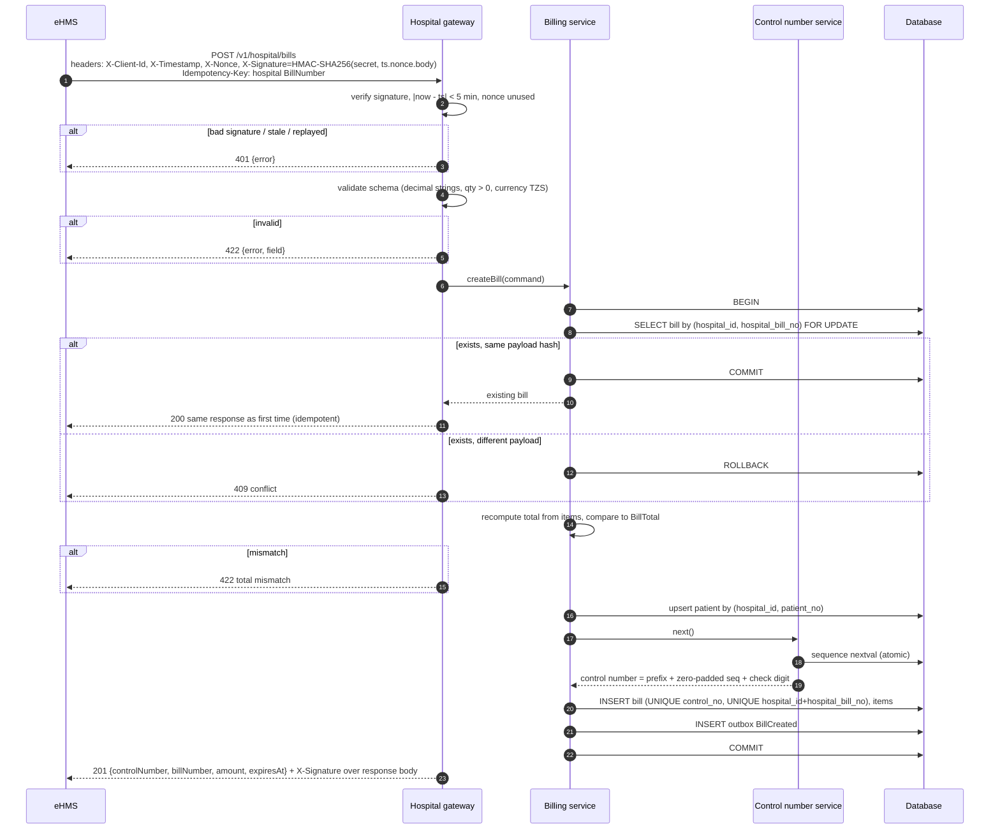

### 14.4 Target: channel validation and payment

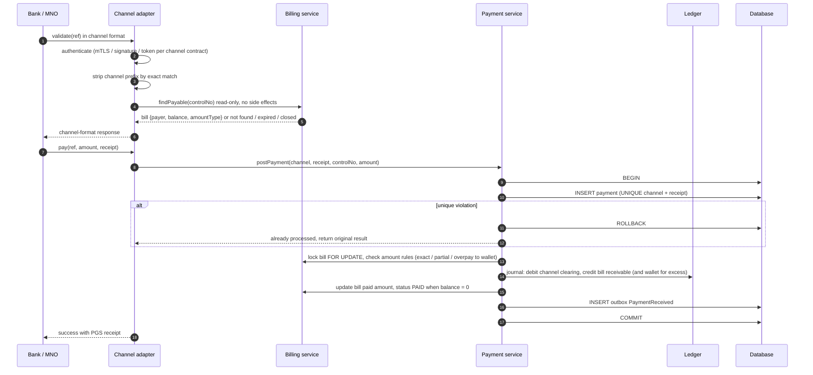

### 14.5 Target: eHMS sync worker

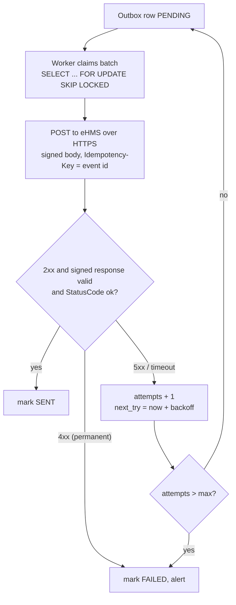

### 14.6 Target bill states

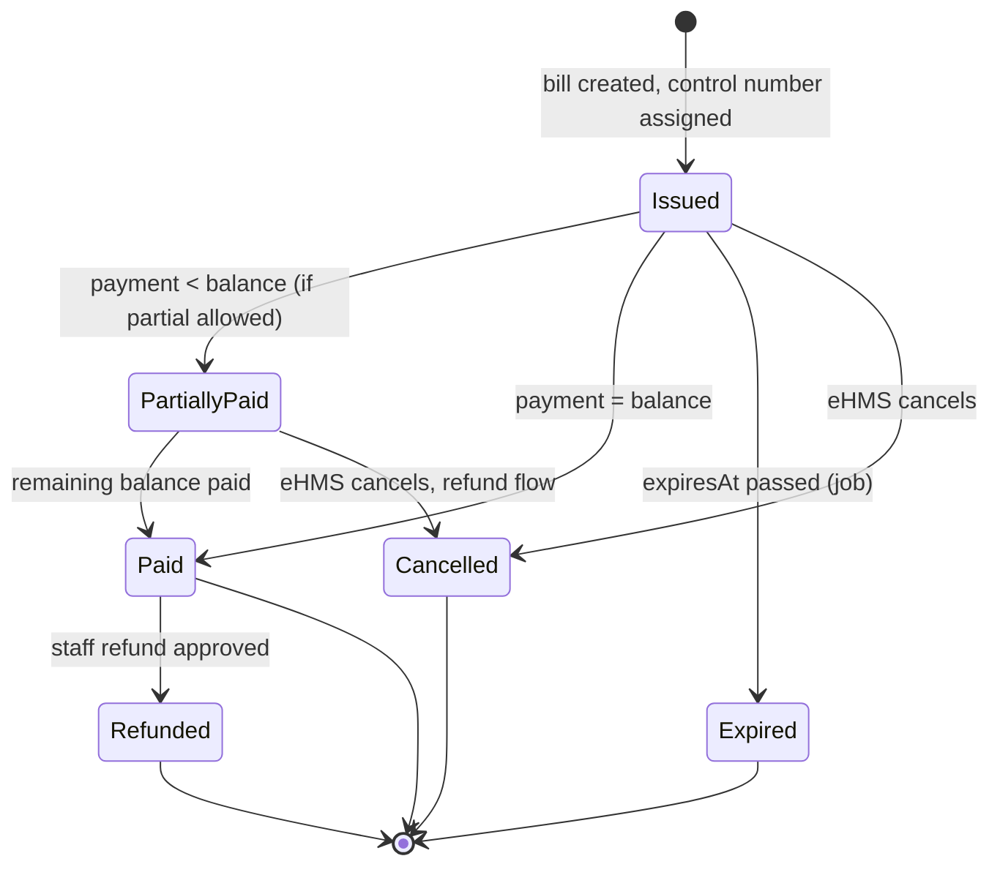

Each state change writes an outbox event, so eHMS learns about payments, expiry and cancellation
through one mechanism.

### 14.7 Core data model

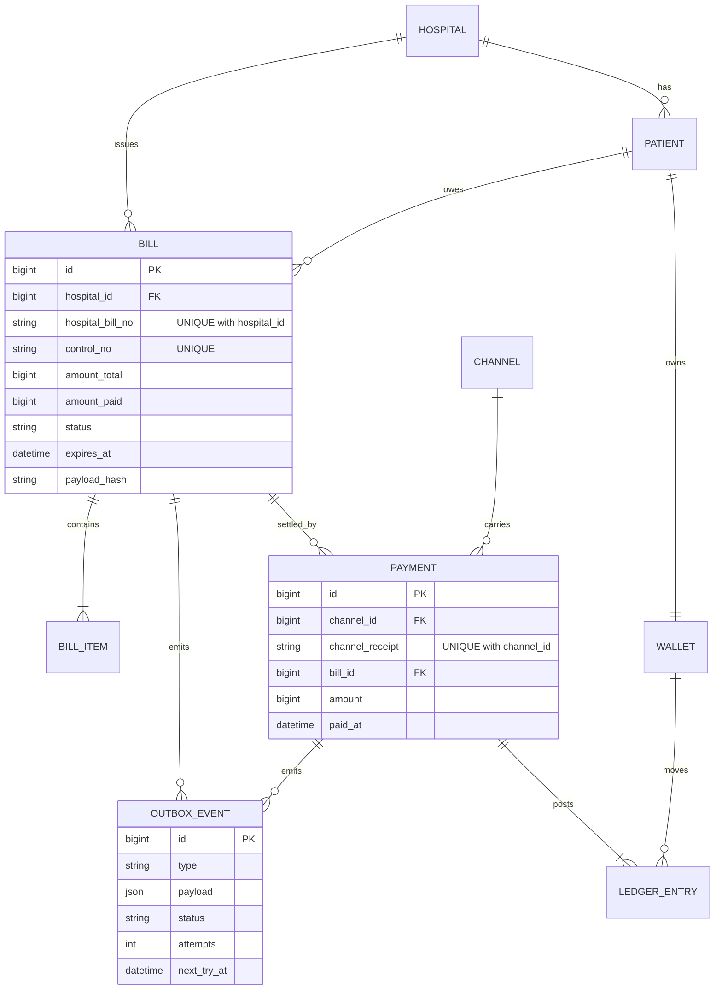

### 14.8 Migration path

1. **Contain now (current system)**: rotate every committed secret; remove the kill switch and
   `Test`, debug and old-copy controllers; turn off auto-routing and list routes explicitly; put
   eHMS and bank endpoints behind TLS.
2. **Freeze contracts**: write OpenAPI specs for the eHMS API and each channel's current wire
   format, so adapters can keep the same external contract while the core changes.
3. **Build core + one adapter**: billing, control numbers, payments, ledger, outbox; ship the
   hospital gateway and one channel (the highest-volume one) first.
4. **Migrate data**: import `bmc_bills`, `bmc_malipo`, wallet master; keep existing control numbers
   valid by reserving the legacy `E...` range and starting the new sequence above it.
5. **Cut over per channel**: point each bank to the new endpoint one at a time, with daily
   reconciliation against the old system until they match.
6. **Decommission**: retire the CodeIgniter/Joomla stack once all channels and eHMS are moved.
